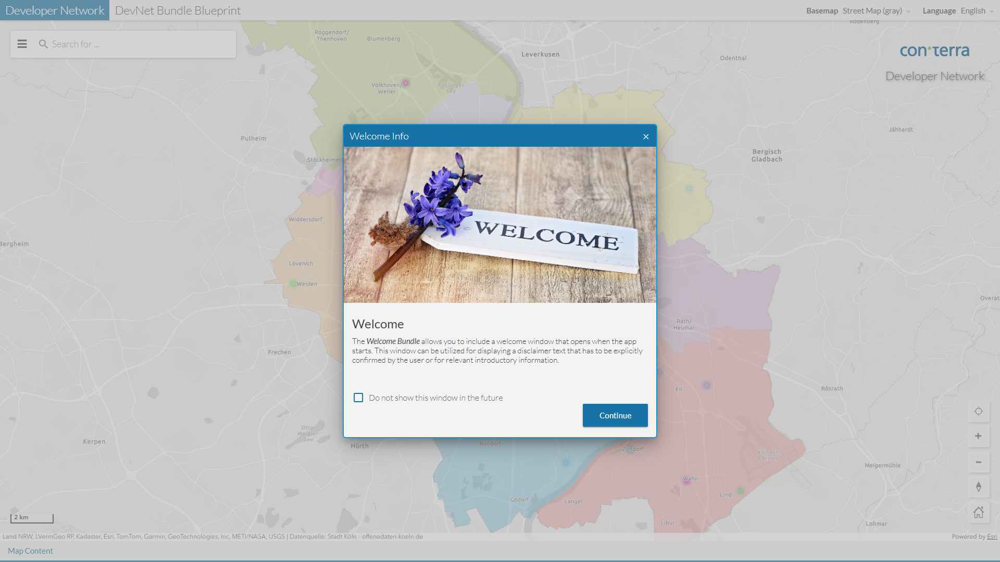

[](https://github.com/conterra/mapapps-welcome/actions/workflows/devnet-bundle-snapshot.yml)


# Welcome bundle
The Welcome Bundle is a widget for displaying a welcome screen. You can either configure it as a disclaimer, with a "I agree"-checkbox, or as a general start screen with a "Do-Not-Show-Again"-checkbox.

## Sample app
https://demos.conterra.de/mapapps/resources/apps/public_demo_welcome/index.html



## Installation guide
1. Add the bundle `dn_welcome` to your app.
2. Customize the content of the welcome window as described in the [Documentation](https://github.com/conterra/mapapps-welcome/tree/main/src/main/js/bundles/dn_welcome) of the `dn_welcome` bundle.

## Development guide
Run the following commands from the project root directory to start a local development server:

```bash
# install all required node modules
$ mvn initialize

# start dev server
$ mvn compile -Denv=dev -Pinclude-mapapps-deps

# run unit tests
$ mvn test -P run-js-tests,include-mapapps-deps
```

## License

This project is licensed under the [Apache License 2.0](LICENSE).

### Third-party software

The following third-party software is compiled into the bundles of this project and distributed with them:

| Component | Used in bundle | License |
|---|---|---|
| [DOMPurify](https://github.com/cure53/DOMPurify) 3.3.1 | `dn_welcome` | Apache-2.0 OR MPL-2.0 (used under Apache-2.0), Copyright Dr.-Ing. Mario Heiderich, Cure53 |

The license texts are shipped with the bundles in `licenses/<component>/`.
